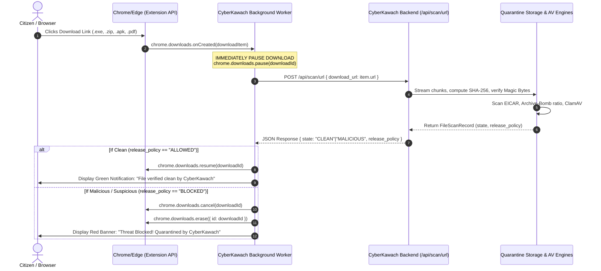

# CyberKawach Browser Extension & Endpoint Agent Specification (Phase 7)

## 1. Architectural Scope & Threat Boundary

Web applications running inside browser sandboxes cannot inspect arbitrary system-level downloads initiated by external applications or other browser tabs due to standard Operating System (OS) and browser security sandboxing boundaries.

To deliver end-to-end download protection across all citizen workflows, CyberKawach implements a two-tier download architecture:

| Tier | Download Origin | Interception Mechanism | Inspection Pipeline | Release Gate |
|---|---|---|---|---|
| **Tier 1: Platform-Managed Downloads** | CyberKawach Web App (`/api/scan/file`, `/api/scan/url`) | Backend Streaming Proxy (`httpx.stream`) | In-memory SHA-256 calculation + sandbox quarantine storage (`data/quarantine/{sha256}.bin`) | Zero-Trust Download Gate (`GET /api/scan/{id}/download`) returns `HTTP 403 Forbidden` if state != `CLEAN` |
| **Tier 2: External Browser Downloads** | Chrome, Edge, Brave, Firefox (web browsing, webmail, attachments) | WebExtension Manifest v3 with `chrome.downloads` and `chrome.webRequest` APIs | Intercepts `chrome.downloads.onCreated`, immediately pauses the download stream, and forwards URL/chunks to CyberKawach scanner | Automatically resumes download upon `CLEAN` response; permanently cancels and alerts user if `MALICIOUS` or `SUSPICIOUS` |

---

## 2. WebExtension Manifest v3 Architecture

### 2.1 Extension Permissions & Security Context
The browser extension requires:
- `downloads`: To listen to `chrome.downloads.onCreated` and manage download lifecycle (`pause`, `resume`, `cancel`, `erase`).
- `downloads.shelf`: To prevent the browser shelf from auto-revealing untrusted files before scanner approval.
- `storage`: To persist user settings, scan history, and active backend endpoint URLs.
- `declarativeNetRequest` / `webRequest`: To inspect HTTP headers (`Content-Disposition`, `Content-Type`) before payload delivery.

### 2.2 Lifecycle Workflow

---

## 3. Local Endpoint Agent (Windows / Linux Daemon)

For non-browser downloads (e.g. downloads through Telegram Desktop, WhatsApp Desktop, Discord, cURL, or email clients), an endpoint agent can monitor the citizen's designated Downloads directory using OS filesystem notifications:

- **Windows:** Win32 `ReadDirectoryChangesW` or .NET `FileSystemWatcher` targeting `%USERPROFILE%\Downloads`.
- **Linux:** `inotify` or `fanotify` hooks on `/home/$USER/Downloads`.
- **Operational Rule:**
  1. Detect newly created `.tmp` or `.crdownload` file stream.
  2. Apply deny-read ACL / permission lock on the target file until hash verification completes.
  3. Transmit file hash to `POST /api/scan/file`.
  4. If malicious, atomically move to quarantined vault directory (`%LOCALAPPDATA%\CyberKawach\quarantine\`) and alert the user.
